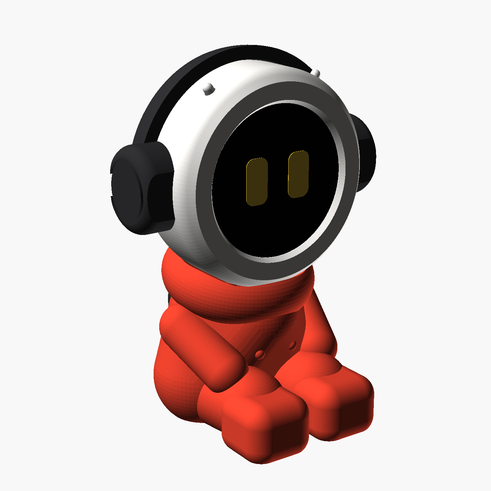
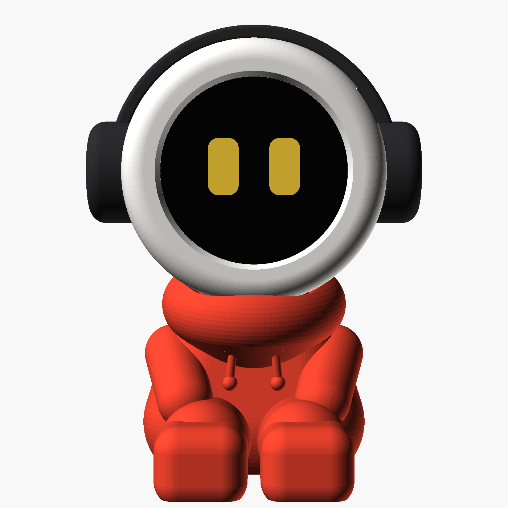
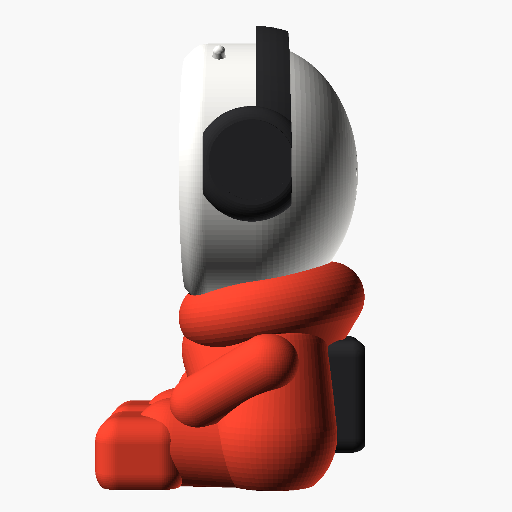
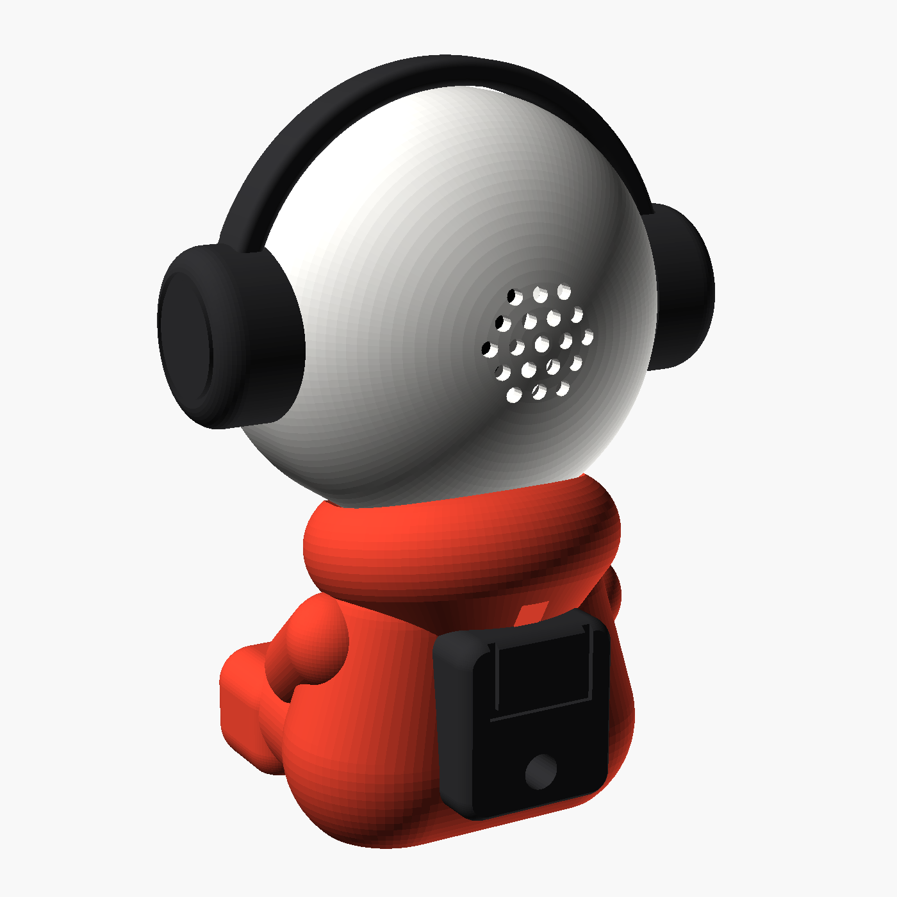
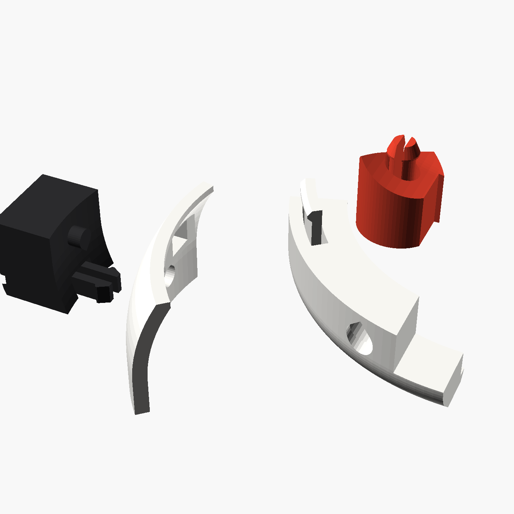
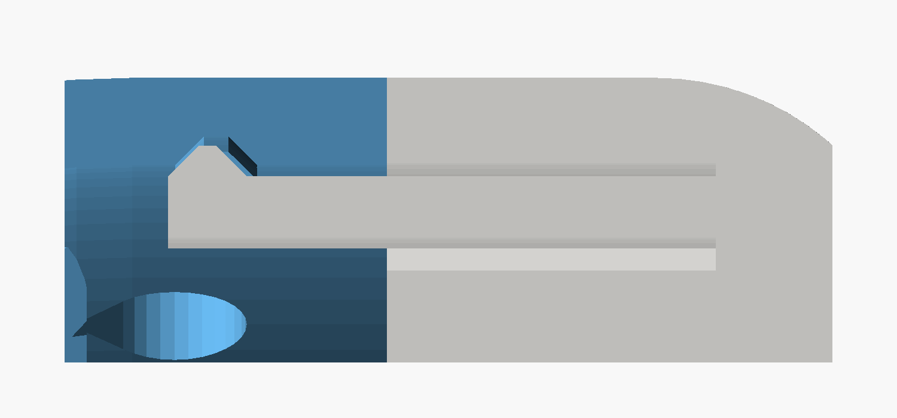
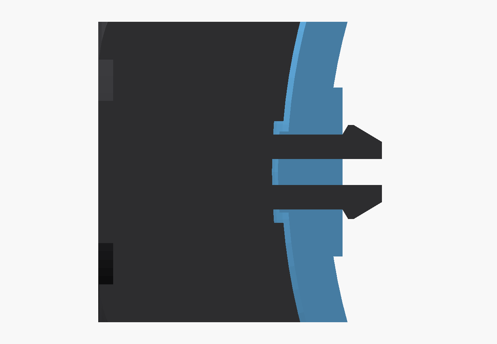

# Beat Buddy

A seated desk robot with a round AMOLED face, headphones and a red hoodie. The face is a Waveshare ESP32-S3-Touch-AMOLED-1.75. A USB-C cable comes in through the backpack and runs up inside the body to the board, so it charges while it sits on your desk.

Everything snaps together. There's no glue, tape, screws or magnets.

| Front | Side | Back |
| --- | --- | --- |
|  |  |  |

**Size:** 84 mm wide across the headphones, 114 mm tall. See [PLAN.md](PLAN.md) for the parts list and the firmware plan, and open [assembly_guide.html](assembly_guide.html) for the illustrated build guide.

## Files

| File | What's in it |
| --- | --- |
| `print/beat_buddy_WHITE_plate.3mf` | Head front, head back and the two push-buttons |
| `print/beat_buddy_BLACK_plate.3mf` | Headphones (one piece) and the backpack |
| `print/beat_buddy_RED_plate.3mf` | Body |
| `print/beat_buddy_ALL_PARTS.3mf` | All 7 parts on one plate, named by colour |
| `print/beat_buddy_*.stl` | Each part on its own, already in print orientation. Print `button.stl` twice. |
| `print/beat_buddy_CLIP_TEST.3mf` / `.stl` | Four small test pieces with every kind of clip. **Print this first** (see below). |
| `cad/beat_buddy.scad` | The editable OpenSCAD model. Board sizes are at the top. |

Every part is a single colour, so you don't need an AMS: print one plate per colour.

## Print the clip test first

How firmly a clip clicks depends on the printer, and no model can predict that exactly. So before the long prints, print `print/beat_buddy_CLIP_TEST.3mf`: **52 minutes and about 6 g** of any colour, no supports. The four pieces are cut out of the real parts, so they behave like the real thing.

| Try this | It should | If it's too loose | If it's too tight |
| --- | --- | --- | --- |
| Push the head front corner (the piece with the round hole) down onto the red peg | Click, and need a firm pull to come off | Raise `clip_barb` by 0.1 | Lower `clip_barb` by 0.1 |
| Push the ear cup's clip through the square window in the thin strip, with the pin in the round hole | Click, and not fall out when you shake it | Raise `hp_clip_barb` by 0.1 | Lower `hp_clip_barb` by 0.1 |
| Stand the thin strip on the head front corner, with the hook inside it, and pinch them together | Let you feel the hook's bump drop into its pocket | Raise `hook_bump` by 0.1 | Lower `hook_bump` by 0.1 |
| Push a button into its slot in the head front and turn the head over | Stay put, but still slide when you press it | Raise `btn_grip` by 0.05 | Lower `btn_grip` by 0.05 |

Those four values are at the top of `cad/beat_buddy.scad`. Change one, run `cad/build.sh`, and only then print the full parts.

Then print in this order, so a problem never costs more than one part: **head front + buttons** (check the board, the buttons and the USB-C slot), **head back**, **headphones and backpack**, and the **body** last.

## Printing

| Part | Time on a Bambu A1 (0.2 mm) | Supports |
| --- | --- | --- |
| Head front | 1 h 31 m | None |
| Head back | 2 h 58 m | **Tree supports (auto)**, for the inside of the dome |
| Push-buttons ×2 | 2 m | None |
| Headphones | 57 m | None |
| Body | 4 h 25 m | None |
| Backpack | 26 m | None |

About 10 hours in total. Filament: about 30 g white (including supports), 10 g black and 35 g of hoodie colour.

- Material: PLA (matte looks best). Walls: 3. Infill: 15% gyroid.
- The orientation is already set in the files, so don't rotate them. The head front prints screen side down and the head back prints with its open side down.
- The head back's supports are all inside the dome, where nobody sees them. Pull them out through the open side.

## How it clips

| Head halves | Head on body | Headphones |
| --- | --- | --- |
|  |  |  |
| Each hook on the head front (grey) has a bump that drops into a pocket inside the rim of the head back (blue). | Each split peg in the collar (red) squeezes through a neck in the head (grey) and springs open above it. | Each cup (black) has a flat split clip that springs open behind the wall of the head back (blue). |

## Parts to buy

- Waveshare ESP32-S3-Touch-AMOLED-1.75 (standard version, not "-G")
- 3.7 V 500 mAh 752035 LiPo (7.5 × 20 × 35 mm) with an MX1.25 2-pin plug
- The 8 Ω 2 W speaker that comes with the board (Waveshare 2030 box speaker, 20 × 30 × 5.5 mm)
- An ordinary **straight** USB-C cable. The stiff part of the plug must be at most 13 mm wide, 8.5 mm thick and 24 mm long, which covers almost all of them.

## Assembly

1. **Buttons:** from inside the head front, push the two T-shaped buttons out through the two small slots near the top, wide end inside.
2. **Board:** hold both buttons pushed outwards and drop the board into the head front, glass first, with the USB-C port at the bottom over the slot. Its PWR switch sits behind the left button and BOOT behind the right one (seen from the front). The board holds the buttons in.
3. **Plugs:** plug the speaker into **SPK** and the battery into **BAT** (check that red goes to +).
4. **Speaker and battery:** push the speaker into the frame inside the head back, cone first, until it stops against the four little ledges. Then push the battery in behind it until it clicks past the four catches.
5. **Close the head:** turn the head back so its bottom notch is over the USB-C slot, and press until the four hooks click into their pockets inside the head back's rim. To open it, pull the halves apart firmly, one side at a time.
6. **Headphones:** push one cup's clip and pin into the slot and hole on one side of the head, then spread the band and click the other cup in.
7. **Cable:** thread the cable in through the hole in the backpack, through the body and up out of the neck. Plug it into the board from below.
8. **Head on body:** lower the head onto the collar so the plug drops into the neck channel, and press down until the two pegs in the collar click into the holes under the head. It now stays on when you turn the robot upside down. To take it off, pull straight up firmly.
9. **Backpack:** push its two pegs into the holes in the body's back until they click.

## Fitting your board

The model uses Waveshare's dimension drawing. If something doesn't line up, measure your board and change these values at the top of `cad/beat_buddy.scad`, then run `cd cad && ./build.sh`:

- `board_d` and `board_t`: the glass diameter, and the depth from the glass to the tops of the brass posts.
- `pcb_back`: the depth from the glass to the back face of the circuit board. The buttons slide in just behind it.
- `usb_depth`: how far back from the glass the centre of the USB-C port is.
- `btn_angle`: how far either side of the top the PWR and BOOT switches are, in degrees.
- `posts`: where the three brass posts are.

The build needs OpenSCAD with the Manifold backend (a 2024 or later development snapshot).
